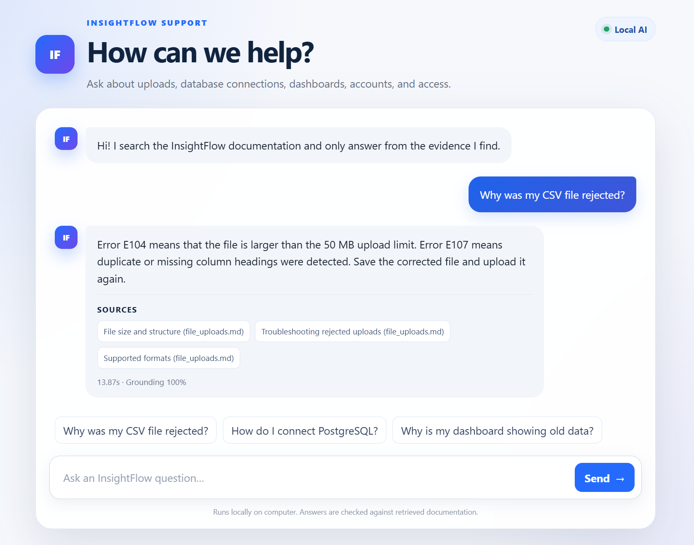
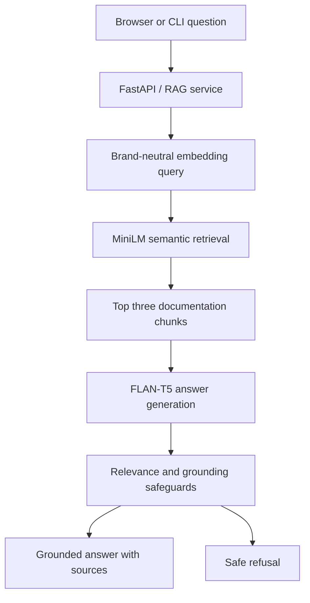

# InsightFlow Support AI

[](https://github.com/Melanie-Goodluck/insightflow-support-ai/actions/workflows/ci.yml)

InsightFlow Support AI is an evaluated retrieval-augmented generation (RAG)
assistant for technical product support. It searches a fictional product
knowledge base, generates an evidence-grounded answer with local open-source
models, cites the retrieved sources, and refuses questions that the
documentation cannot support.

The project goes beyond a basic RAG demo: it compares retrieval strategies,
records automatic and human evaluation results, tests failure cases, exposes a
FastAPI service and responsive web interface, and includes production-oriented
controls for logging, health monitoring, concurrency and containerisation.

The complete application runs locally on CPU and makes no paid AI API calls.

## Application preview



## Highlights

- Semantic retrieval with `sentence-transformers/all-MiniLM-L6-v2`
- Local answer generation with `google/flan-t5-base`
- Brand-neutral query transformation that fixed an observed retrieval miss
- Grounding and relevance checks with safe refusal behaviour
- Answer citations and visible retrieved evidence
- Labelled retrieval and end-to-end RAG evaluation datasets
- FastAPI backend and responsive browser interface
- Privacy-conscious structured logs with request IDs and latency
- Liveness and readiness health endpoints
- CPU and memory protection for simultaneous inference requests
- Non-root Docker image and automated GitHub Actions checks
- 37 automated tests covering retrieval, generation, evaluation and API behaviour

## Results

### Retrieval benchmark

The retrievers were evaluated on the same 22 labelled questions.

| Retriever | Top-1 accuracy | Top-3 accuracy | Mean Reciprocal Rank |
| --- | ---: | ---: | ---: |
| Keyword baseline | 54.5% | 77.3% | 0.636 |
| Semantic retrieval | 86.4% | 100.0% | 0.924 |
| Brand-neutral semantic retrieval | **86.4%** | **100.0%** | **0.924** |
| Hybrid experiment | 72.7% | 86.4% | 0.795 |

The hybrid experiment corrected one difficult team-invitation query but reduced
overall benchmark performance, so it was rejected. A narrower transformation
that removes the repeated product name only from the embedding query corrected
that failure while retaining the semantic retriever's stronger overall scores.

### End-to-end RAG benchmark

The complete pipeline was evaluated on 12 answerable and 6 unanswerable
questions.

| Automatic metric | Result |
| --- | ---: |
| Answer/refusal routing accuracy | **100.0%** |
| Answerable-question answer rate | **100.0%** |
| Unanswerable-question refusal accuracy | **100.0%** |
| False-refusal rate | **0.0%** |
| Unsupported-answer rate | **0.0%** |
| Expected-source retrieval | **100.0%** |
| Mean response time on the evaluation computer | 1.58 s |
| Median response time on the evaluation computer | 1.39 s |

Human review produced 91.7% overall correctness, 100% faithfulness and 83.3%
overall helpfulness. On answerable questions alone, correctness was 87.5% and
helpfulness was 75.0%. These results describe a small controlled dataset, not
general performance on every support domain.

## Architecture



The original user question is preserved for generation. Only the semantic
search query is made brand-neutral. This prevents a repeated product name from
dominating the embedding while keeping the user's meaning intact.

## Safety and failure handling

The assistant does not return every model output automatically.

- A similarity threshold rejects questions with weak retrieved evidence.
- A grounding-coverage check rejects answers unsupported by the retrieved text.
- A guarded fallback replaces vague heading-only output with documentation text
  only when retrieval is sufficiently strong.
- Compact factual answers, such as supported formats or time limits, are kept.
- Unsupported questions receive a clear handoff to human support.
- Diagnostic fields retain the raw output, decision reason, scores and evidence
  for error analysis.

## Production engineering

- Models and documentation load once at application startup.
- `/api/health/live` confirms that the web process is alive.
- `/api/health/ready` confirms that the RAG service has loaded.
- Each response includes an `X-Request-ID` header.
- Structured JSON logs record request ID, method, path, status and duration.
- Questions and request bodies are excluded from logs to protect privacy.
- Model work runs outside the main async request loop, keeping health checks
  responsive during generation.
- A semaphore processes one inference request at a time by default. Excess
  requests briefly wait and then receive `503 Service Unavailable` with a
  `Retry-After` header.
- Docker runs the service as a non-root user with one worker, preventing local
  models from being duplicated in memory.
- GitHub Actions runs Python tests, JavaScript syntax validation and a production
  Docker build on every push and pull request.

The concurrency settings can be changed with `MAX_CONCURRENT_INFERENCE` and
`INFERENCE_QUEUE_TIMEOUT_SECONDS`. Increasing concurrency also increases CPU
and memory pressure.

## Technology

- Python
- FastAPI and Uvicorn
- Sentence Transformers
- Hugging Face Transformers
- FLAN-T5
- HTML, CSS and JavaScript
- Docker
- GitHub Actions
- Python `unittest`

## Run locally

Python 3.10 or newer is recommended. The first run downloads the embedding and
generation models from Hugging Face; later runs reuse the local model cache.

Create a virtual environment:

```bash
python -m venv .venv
```

Activate it on Windows PowerShell and install the dependencies:

```powershell
.venv\Scripts\Activate.ps1
python -m pip install -r requirements.txt
```

Start the web application:

```powershell
python -m uvicorn web_app:app
```

Open `http://127.0.0.1:8000` in a browser. Interactive API documentation is
available at `http://127.0.0.1:8000/docs`.

Avoid development auto-reload on a memory-constrained computer because it can
start an additional process and load another copy of the models.

### Other entry points

Run the terminal RAG assistant:

```bash
python rag_app.py
```

Run the original keyword retriever:

```bash
python app.py
```

Compare retrieval methods:

```bash
python compare_retrievers.py
```

## Evaluation and diagnosis

Evaluate all retrieval methods:

```bash
python evaluate_retrievers.py
```

Evaluate the complete RAG pipeline:

```bash
python evaluate_rag.py
```

Inspect one question in detail:

```bash
python diagnose_rag.py "How can I invite a colleague to InsightFlow?"
```

The diagnostic command displays semantic, brand-neutral and hybrid candidate
evidence, similarity scores, raw model output, grounding coverage, decision
reason and final response. Evaluation CSV files are generated locally for
question-level analysis and human scoring.

## Automated tests

```bash
python -m unittest discover -s tests -v
```

The 37-test suite covers retrieval, semantic query transformation, generation
safeguards, evaluation calculations, API validation, structured logging,
health endpoints and simultaneous-request protection.

## Run with Docker

```bash
docker build -t insightflow-support-ai .
docker run --rm -p 8000:8000 insightflow-support-ai
```

The first container start downloads both models. The health check allows up to
five minutes for this initial startup. The image uses a configurable `PORT` and
one Uvicorn worker.

## Project structure

```text
insightflow-support-ai/
├── .github/workflows/       continuous integration
├── data/product_docs/       fictional product knowledge base
├── data/*.json              labelled evaluation questions
├── src/                     retrieval, generation and evaluation modules
├── static/                  responsive browser interface
├── tests/                   automated regression tests
├── Dockerfile               production container definition
├── app.py                   keyword-search CLI
├── rag_app.py               complete RAG CLI
├── web_app.py               FastAPI application
├── evaluate_retrievers.py   retrieval benchmark runner
├── evaluate_rag.py          end-to-end benchmark runner
└── diagnose_rag.py          single-question diagnostic tool
```

## Example questions

- Which file formats can I upload to InsightFlow?
- How do I connect a PostgreSQL database?
- Why is my dashboard showing old data?
- How can I invite a colleague to InsightFlow?
- What does error E104 mean?

An intentionally unsupported question, such as asking how to permanently delete
an account, demonstrates the refusal path.

## Limitations and next steps

- The knowledge base and labelled datasets are deliberately small and fictional.
- The CPU-friendly generator can produce less polished answers than a larger
  hosted model.
- Thresholds were calibrated on a controlled evaluation set and need broader
  validation before use with real customers.
- Human review was performed by one reviewer and is therefore subjective.
- A real deployment would also require authentication, organisation-specific
  access control, rate limiting, external monitoring and a larger evaluation
  dataset.
- A public live demo is not currently hosted because suitable always-on model
  memory requires paid compute. The repository remains fully reproducible
  locally and through its tested Docker build.
